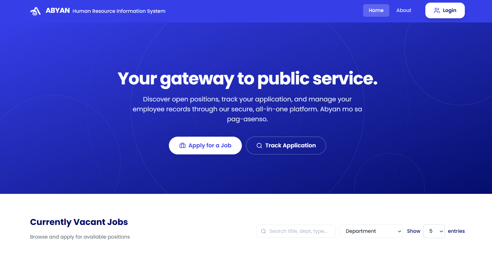
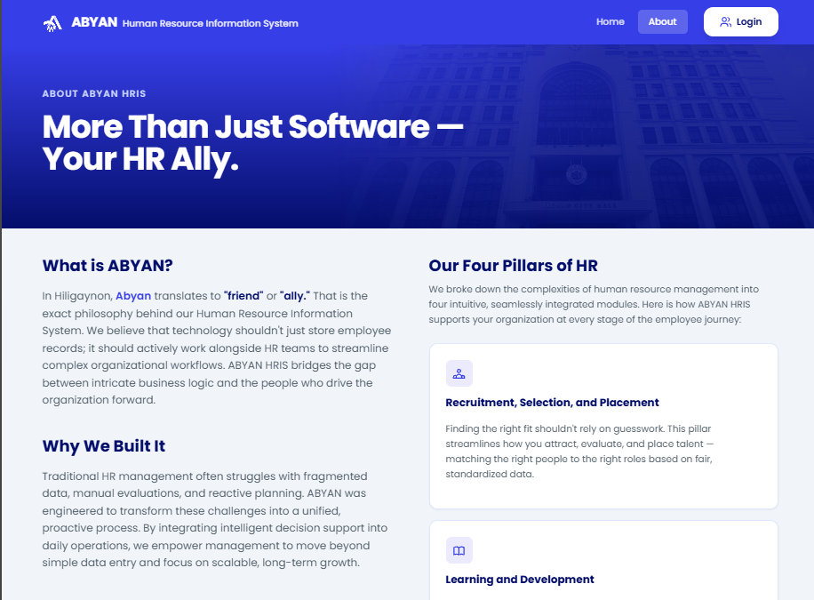
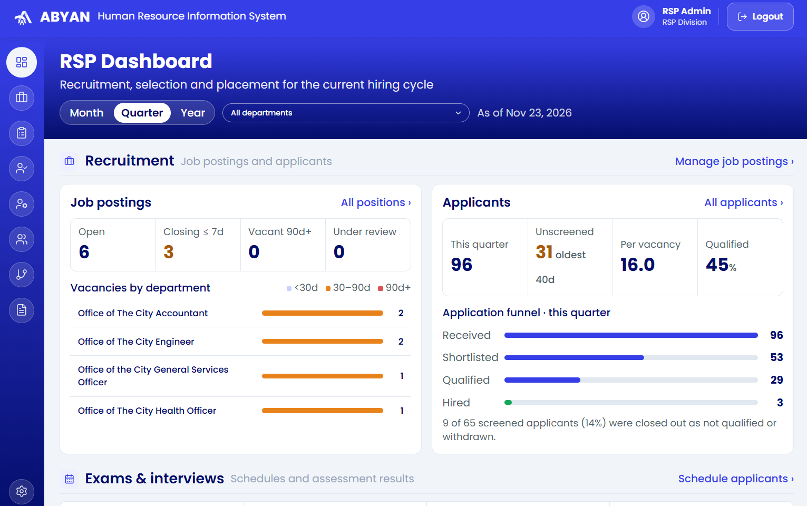
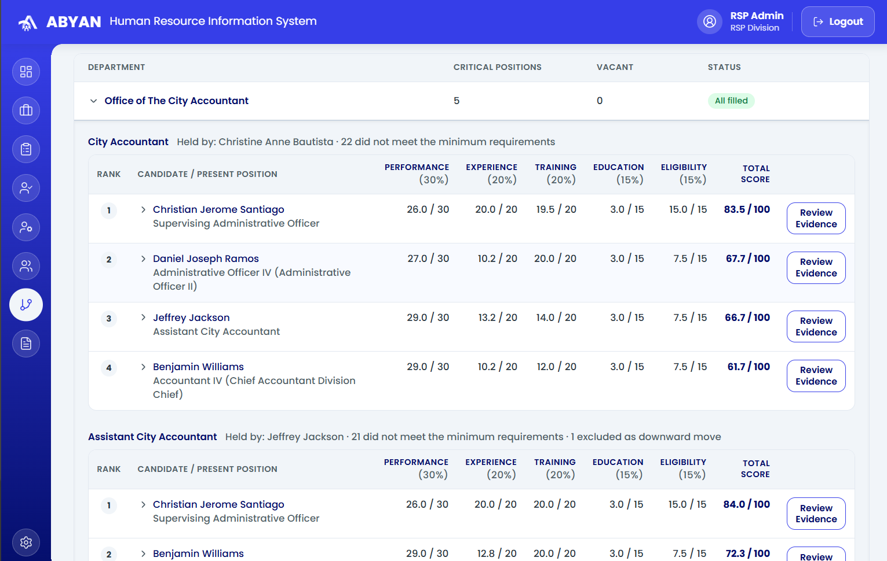
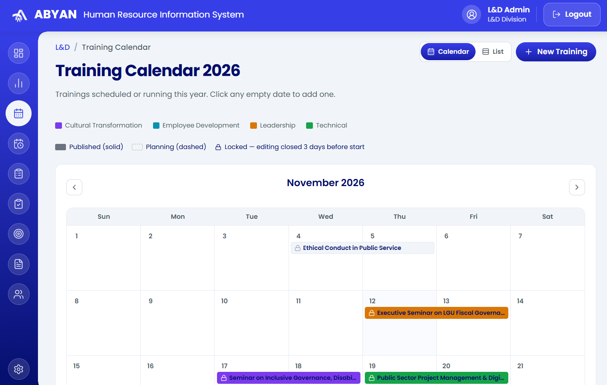
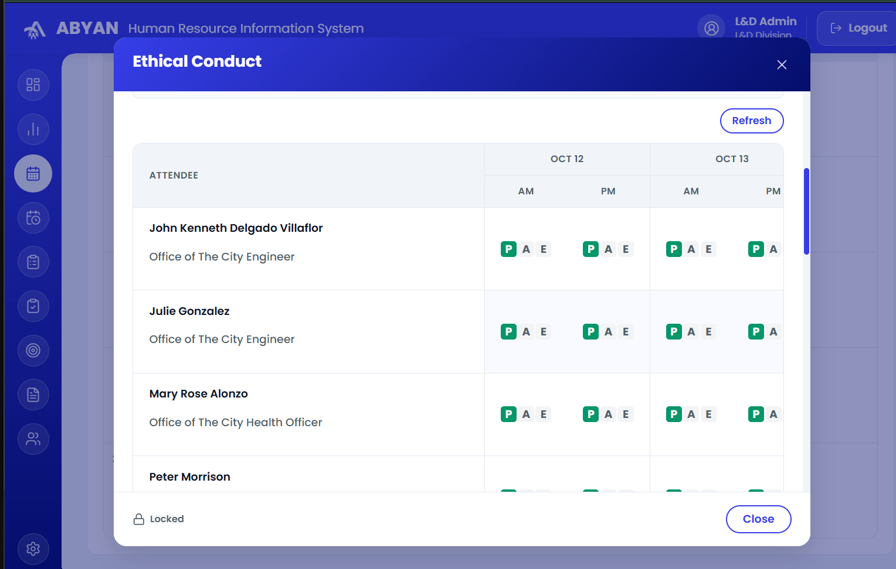
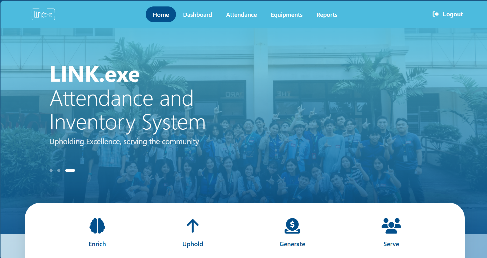
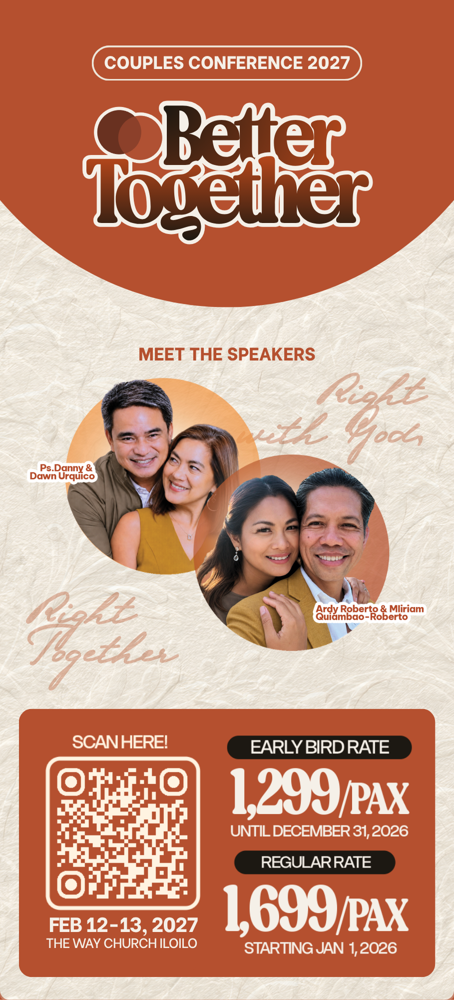
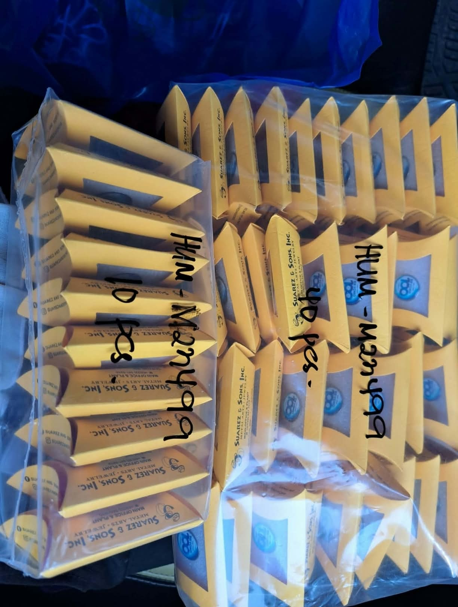

<!-- ============================================= -->
<!-- TRISHA MAE LOMBENDENCIO | GITHUB README       -->
<!-- BLACK + NEON GREEN THEME                      -->
<!-- ============================================= -->

  

  

  ⊹₊˚‧︵‿₊୨ᰔ୧₊‿︵‧˚₊⊹

<!-- ABOUT ME -->

<tr>
<td bgcolor="#000000" align="center">

<h1>TRISHA MAE LOMBENDENCIO</h1>

<b>Bachelor of Science in Information Systems</b>
 
Major in Business Application Development
 
West Visayas State University • Batch 2027
 
Fourth-Year Student
  
<i>I love coffee and art &lt;3</i>

 

</td>
</tr>

<tr>
<td bgcolor="#000000" align="center">

</td>
</tr>

<!-- PROFILE -->

<tr>
<td bgcolor="#000000">

<h3>▸ PROFILE</h3>

I'm a fourth-year BS Information Systems student at West Visayas State University, majoring in Business Application Development, with a growing focus on web development, UI/UX, and software architecture.

My college journey combines technology and creativity. I previously served as Vice President for Internal Affairs (Trainings) at LINK.exe and volunteered with The Way Church Creatives, organizing multimedia workshops, designing event materials, and collaborating with production teams.

Through my coursework and undergraduate thesis, I've gained experience translating business processes into system requirements, database structures, and frontend interfaces.

I enjoy building projects where functional system logic meets thoughtful visual design.

</td>
</tr>

<!-- PROJECTS -->

<tr>
<td bgcolor="#000000">

<h3>▸ FEATURED PROJECTS</h3>

  

<b>01. HRIS &amp; DECISION SUPPORT SYSTEM (DSS) — ABYAN HRIS</b>
 
<i>Undergraduate Thesis | HRMO, Iloilo City Government</i>
 
<i>Role: System Software Architecture, Diagrams &amp; Frontend UI/UX</i>
  

A web-based Human Resource Information System integrating Recruitment, Selection and Placement, Performance Management, and Learning and Development. I mainly worked on the system software architecture, diagrams, frontend UI/UX.

<b>KEY FEATURES</b>
<ul>
<li>Employee competency assessment and gap analysis</li>
<li>Data-driven training recommendations</li>
<li>Weighted Sum Model (WSM) for succession candidate ranking</li>
<li>Descriptive analytics for HR decision support</li>
<li>CSC-aligned automated training classification</li>
</ul>

<b>SAMPLE OUTPUTS (UNDERGRADUATE HRIS)</b>
  
<table width="100%">
<tr>
<td width="33.33%" align="center" bgcolor="#000000">
<b>Homepage</b>  

</td>
<td width="33.33%" align="center" bgcolor="#000000">
<b>About ABYAN</b>  

</td>
<td width="33.33%" align="center" bgcolor="#000000">
<b>RSP Dashboard</b>  

</td>
</tr>
<tr>
<td width="33.33%" align="center" bgcolor="#000000">
<b>Succession Planning</b>  

</td>
<td width="33.33%" align="center" bgcolor="#000000">
<b>Training Calendar</b>  

</td>
<td width="33.33%" align="center" bgcolor="#000000">
<b>Training Attendance</b>  

</td>
</tr>
</table>
 

<b>FOCUS:</b> HRIS • DSS • System Architecture • Frontend UI/UX • Data Analytics

<b>02. LINK.EXE ATTENDANCE &amp; INVENTORY TRACKING SYSTEM (AITS)</b>
 
<i>Organizational Management System | LINK.exe, WVSU-CICT</i>
 
<i>Role: User Interface Designer</i>
  

An administrative system designed to centralize organizational attendance monitoring and equipment inventory management, where I worked as the User Interface designer.

<b>KEY FEATURES</b>
<ul>
<li>Event-based attendance monitoring</li>
<li>Daily equipment borrowing transactions</li>
<li>Centralized inventory records</li>
<li>Administrative tracking and management</li>
</ul>

<b>HOME PAGE OUTPUT</b>
  

<b>FOCUS:</b> UI Design • CRUD Operations • Database Management • Process Automation

<b>03. PAWPOINT – VETERINARY APPOINTMENT MANAGEMENT SYSTEM</b>
 
<i>Web Application | Rebadulla Animal Care</i>
  

A web-based appointment management solution designed to streamline veterinary clinic scheduling and appointment handling.

<b>KEY FEATURES</b>
<ul>
<li>Centralized appointment requests</li>
<li>Veterinary clinic schedule organization</li>
<li>Appointment coordination between pet owners and clinic personnel</li>
<li>Reduced manual scheduling and potential booking conflicts</li>
</ul>

<b>FOCUS:</b> Web Development • Appointment Management • Business Process Analysis

</td>
</tr>

<!-- CREATIVE WORK -->

<tr>
<td bgcolor="#000000">

<h3>▸ CREATIVE SUITE & FREELANCE</h3>

I also explore freelance graphic design, creating visual materials for organizations, events, and creative initiatives.

<b>SELECTED CREATIVE WORKS</b>
<ul>
<li>N-PAX × BENG – Anniversary polo shirt graphics and commemorative pins</li>
<li>UNDONE Worship Concert – Entrance gate arch graphics</li>
<li>The Way Church Iloilo – Lifestyle T-shirt designs</li>
<li>TWC Better Together Conference 2027 – Billboards and promotional flyers</li>
<li>TWC Regular Creatives – Sermon posts, slides, covers, and carousel posts</li>
<li>LINK.exe The Design District – Training program branding</li>
<li>LINK.exe MediaMorphosis 2025 – Certificates and promotional materials</li>
<li>LINK.exe Organizational Publications – Social media graphics and carousel posts</li>
<li>BSIS Academic Cohorts – Custom batch T-shirt graphics</li>
</ul>

</td>
</tr>

<!-- PORTFOLIO OUTPUTS -->

<tr>
<td bgcolor="#000000" align="center">

<h3>▸ PORTFOLIO OUTPUTS</h3>

Explore my GitHub profile or view the full portfolio archive on Google Drive.  

  

<!-- 1. EVENT & BRAND GRAPHICS -->
<b>EVENT &amp; BRAND GRAPHICS</b>
  

TWC UNDONE Concert Arch Gate 

  

<table width="100%">
<tr>
<td width="65%" align="center" bgcolor="#000000">
Better Together Couples Conference Billboard  

</td>
<td width="35%" align="center" bgcolor="#000000">
Conference Flyer  

</td>
</tr>
</table>

<!-- 2. SOUVENIR PINS -->
<b>CEBU N-PAX × BENG SOUVENIR PINS</b>
  

<table width="100%">
<tr>
<td width="50%" align="center" bgcolor="#000000">
Actual Pins  

</td>
<td width="50%" align="center" bgcolor="#000000">
Pin Design Sheet  

</td>
</tr>
</table>

<!-- 3. APPAREL & T-SHIRT MOCKUPS -->
<b>APPAREL &amp; T-SHIRT DESIGNS</b>
  

BSIS T-Shirt Design 

  

<table width="100%">
<tr>
<td width="33.33%" align="center" bgcolor="#000000">
The Way Lifestyle  

</td>
<td width="33.33%" align="center" bgcolor="#000000">
Orange &amp; Cream Mockup  

</td>
<td width="33.33%" align="center" bgcolor="#000000">
White Mockup Draft  

</td>
</tr>
</table>

<!-- 4. SOCIAL & CREATIVE HIGHLIGHTS -->
<b>SOCIAL &amp; CREATIVE HIGHLIGHTS</b>
  

<table width="100%">
<tr>
<td width="50%" align="center" bgcolor="#000000">
Fuzzy Flora  

</td>
<td width="50%" align="center" bgcolor="#000000">
Lakbay Lense  

</td>
</tr>
</table>

</td>
</tr>

<!-- TECH STACK -->

<tr>
<td bgcolor="#000000">

<h3>▸ TECH STACK & TOOLS</h3>

<table width="100%">
<tr>
<td width="33.33%" valign="top">

<b>LANGUAGES & FRONTEND</b>
  

 
 
 
 
 
 
 
 
 

</td>

<td width="33.33%" valign="top">

<b>ENVIRONMENT & TOOLS</b>
  

 
 
 
 
 
 
 

</td>

<td width="33.33%" valign="top">

<b>BACKEND & DATABASE</b>
  

 
 
 
 

</td>
</tr>
</table>

</td>
</tr>

<!-- LEADERSHIP -->

<tr>
<td bgcolor="#000000">

<h3>▸ LEADERSHIP & COMMUNITY</h3>

<b>VICE PRESIDENT FOR INTERNAL AFFAIRS (TRAININGS)</b>
 
LINK.exe, WVSU-CICT | A.Y. 2024–2025

<ul>
<li>Led training initiatives and multimedia workshops.</li>
<li>Authored organizational resolutions and documentation for creative submission workflows and quality standards.</li>
</ul>

<b>BOARD MEMBER FOR INTERNAL AFFAIRS</b>
 
LINK.exe, WVSU-CICT | A.Y. 2023–2024

<ul>
<li>Helped organize workshops in photography, videography, graphic design, motion graphics, and livestreaming.</li>
<li>Coordinated event logistics, documentation, and multimedia coverage.</li>
</ul>

<b>COMMUNITY ENGAGEMENT</b>
<ul>
<li>Initiated and headed The Design District, a seven-session creative learning program.</li>
<li>Spearheaded MediaMorphosis: Creativity and Synergy in Fusion.</li>
<li>Served as Resource Speaker for Project Tekno: Technology with a Purpose (Waves 1 & 2).</li>
<li>Participated in Mr. & Ms. WVSU-CICT 2025.</li>
</ul>

</td>
</tr>

<!-- RECOGNITION -->

<tr>
<td bgcolor="#000000">

<h3>▸ ACADEMIC HONORS & RECOGNITION</h3>

<ul>
<li>Dean's Lister (2024, 2025, 2026)</li>
<li>CICT Parangal 2025 Leadership Award</li>
<li>College Service Award (2024, 2025, 2026)</li>
<li>AI-Driven Smart Farming Strategy Based on Plant Data Analytics – DEPD Regional Office VI (2025)</li>
<li>NextGenPH: Youth Innovators Reimagining Public Service Innovation Contest – National Youth Commission (2024)</li>
</ul>

</td>
</tr>

<!-- CONTACT -->

<tr>
<td bgcolor="#000000" align="center">

 

<b>[ ESTABLISHING_CONNECTION... ]</b>

  

  

<i>// Always open for collaboration and coffee.</i>

  

</td>
</tr>
</table>

<!-- ============================================= -->
<!-- SECOND SEMESTER 2026 GITHUB ACTIVITY           -->
<!-- ============================================= -->

 

  

  
    <b>JULY — DECEMBER 2026</b>
     
    <i>Six months of learning, building, and creating.</i>
  

<!-- MONTHLY CONTRIBUTIONS -->

<table width="100%">
<tr>
<td width="50%" align="center" bgcolor="#000000">

<b>JULY 2026</b>

</td>

<td width="50%" align="center" bgcolor="#000000">

<b>AUGUST 2026</b>

</td>
</tr>

<tr>
<td width="50%" align="center" bgcolor="#000000">

<b>SEPTEMBER 2026</b>

</td>

<td width="50%" align="center" bgcolor="#000000">

<b>OCTOBER 2026</b>

</td>
</tr>

<tr>
<td width="50%" align="center" bgcolor="#000000">

<b>NOVEMBER 2026</b>

</td>

<td width="50%" align="center" bgcolor="#000000">

<b>DECEMBER 2026</b>

</td>
</tr>
</table>

<!-- OVERALL GITHUB STATISTICS -->

 

  

  

  

<!-- CONTRIBUTION STREAK -->

  

 

<!-- FOOTER -->

  
    <b>THANK YOU FOR VISITING MY PROFILE!</b>
     
    <i>Turning ideas into systems, and creativity into pixels.</i>
      
     LEARN • BUILD • CREATE • REPEAT
  

